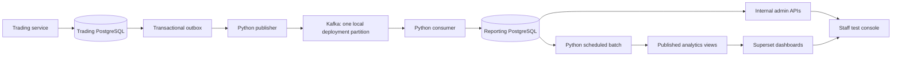

# Architecture and data meaning

## Responsibilities

The existing trading PostgreSQL database remains authoritative. The internal
backend has no trading-database connection. Its administrative commands forward
the caller's JWT to the existing trading service, which validates ADMIN access,
locks and updates the account/instrument, and records the action locally in the
same transaction. Its reads use the reporting database.

`internal-backend` has its own Maven project, source tree, Dockerfile and process.
It builds independently, with no dependency on the client backend JAR, JPA entities
or repositories. Its `com.avengers.internal` namespace contains `admin`,
`analytics`, `security` and `common` packages. Local DTOs describe the JSON contract
with the trading API; JWT verification implements the existing auth token contract.
The optional root Maven build builds both independent projects for convenience.

The trading service's `com.avengers.endgame.tradingcontrol` package contains only
authoritative account/instrument commands and their transactional audit writes.
Trade-event and pricing-evidence production also remains with the trading service
because it must run inside the source business transactions. Staff reads, exports,
analytics and Superset integration all belong to `internal-backend`.

## Audit scope

New source lifecycle records cover:

1. **Submitted:** an order successfully passes validation and is persisted. This
   is the submission timestamp; its operational status is normally `accepted`.
   Requests rejected before persistence are not a complete request-audit system.
2. **Rejected:** a terminal business-rule execution rejection, or a failed pricing
   validation attempt. `terminal=false` identifies a retryable pricing attempt.
   A temporary provider outage still follows existing retry behavior; it is not
   misrepresented as a permanent order rejection.
3. **Filled:** successful full execution. Cash and quantity come from the immutable
   fill and linked cash ledger, using the actual rounded settlement amount.

The existing backend already implements cancellation, amendments and stop
activation. This local deployment does not add audit steps for those operations. The current
order projection can still reflect the operational status.

Market-buy submission evidence and execution evidence preserve the quote actually
used: price, bid, ask, provider timestamp, source and stale flag. Evidence includes
an observation timestamp and phase. Invalid timestamp/symbol/currency/price
attempts preserve the failed observation in a separate transaction while leaving
the order retryable. Successful observations commit with the business transaction.
A provider quote marked stale remains valid under the existing simulator policy.
No extra paid quote is requested just to populate an audit panel.

`cash_ledger` links the original fill/transaction UUID to its signed cash movement.
Fills supply buy/sell quantity movements. Deposits, withdrawals and dividends are
included, but account numbers, passwords and refresh tokens are never extracted.
Cash-after/quantity-after fields remain unknown where no reliable recorded value
exists; the consumer does not invent them.

## Reporting database

Existing public mirror tables and `admin.*` views are retained for compatibility
with the already-written admin API. New work has dedicated schemas:

| Schema | Content |
|---|---|
| `audit` | Original ingested envelopes, preserved quote evidence and current order state |
| `integration` | Pipeline heartbeat, batch history, published-batch pointer and approved dashboard registry |
| `analytics` | Immutable per-batch trade facts and views exposing the published batch for each report date |

Original events, pricing evidence, financial movements and batch facts are
append-only. Mutable projections can advance to newer source state. Rebuilding a
report produces a new batch and switches its published pointer atomically; it does
not rewrite the old batch. Existing legacy monthly segmentation tables are not
populated by this local deployment.

Roles are separate: the internal API can read audit data and append view logs;
the worker can maintain projections and batches; Superset's reporting connection
can only SELECT approved reporting views. Superset metadata lives in a different
database on the reporting PostgreSQL instance.

## Scheduled report definition

Each report covers **[00:00, configured cutoff) America/New_York on that date**.
The initial cutoff is 19:00. Admins and analysts can change the shared time in the
Reports screen; changes take effect the next local day. The selected time controls
both report generation and the data cutoff. A trade at or after that cutoff is outside
this version's same-day coverage. Those trades remain
visible to admin audit. They are not silently moved into the next day's report.
Changing this to a full calendar-day report requires a later run/correction policy.

The scheduler reads the saved schedule every 30 seconds and runs after its cutoff once a source heartbeat
at or beyond the cutoff has reached the consumer. ZoneInfo handles EST/EDT.
Execution time is the fill's recorded time, not the consumer's arrival time.
Each batch saves its period, cutoff, heartbeat, start/completion and status.

Reconciliation compares fill counts and **actual recorded cash amounts**. Failure
leaves the previously published batch visible. A manual rerun can incorporate
late-arriving source records. The local deployment heartbeat is an operational freshness signal,
not a rigorous distributed transaction watermark. A process killed during a batch
may leave a `running` attempt; a later run creates a replacement attempt.

The prepared dashboards are business overview, instrument activity and client
trading activity. They have date, ticker, security class, side and client filters.
Portfolio valuations, segments, historical prices and login-based activity metrics
remain deferred; the required snapshot definitions/inputs are not yet available.

## Delivery and recovery

SQL triggers append outbox messages in the business transaction. A single Python
publisher sends only committed rows, waits for Kafka acknowledgment, then marks
delivery. A single-partition topic keeps the local deployment's events ordered in the stream.
No Kafka connection is made while accepting or executing a trade.

The consumer writes its deduplication record and all derived rows in one database
transaction, then commits the Kafka offset. Replayed UUIDs have no additional
financial effect. Unsupported or invalid events stop processing rather than
silently skipping financial data. Container restart retries the uncommitted event.
Multi-partition sequencing, dead-letter tooling, retention automation and advanced
outage recovery are intentionally deferred.

The publisher performs a consistent initial snapshot on startup, followed by the
outbox. Stable snapshot IDs make repeated startup safe. Existing order states are
labelled `provenance=snapshot`; missing historic quotes and lifecycle steps cannot
be reconstructed. Ingestion compares source timestamps before replacing mirrors.

## Authentication and embedding

The existing auth JWT is verified for signature, time, issuer, the `endgame-staff` audience
and MFA proof. `ADMIN` or `SUPER_ADMIN` is required on `/api/v1/admin/**`; `ANALYST`, `ADMIN` or
`SUPER_ADMIN` on `/api/v1/analytics/**`. `X-Admin-Id` is ignored. The actor UUID/email comes from the
verified token. Frontend route guards are useful navigation but do not replace API
checks.

The analyst API maps an approved dashboard key to its stored embedded UUID and
requests a five-minute Superset guest token using a restricted service account.
Service credentials never reach the browser. All authorized staff currently share the
same prepared reporting scope, so guest tokens use no additional client row filter.
If staff-specific client access is introduced, server-derived RLS rules are needed.

Superset is pinned to 6.0.0. Bootstrap uses that version's model API to create
initial datasets/charts and preserves existing authored layouts on rerun.
Reference: [Superset embedding](https://superset.apache.org/user-docs/using-superset/embedding/)
and [Kafka delivery semantics](https://kafka.apache.org/41/design/design/#message-delivery-semantics).

Schedule history is append-only in `integration.report_schedules`, with the verified
staff UUID, save timestamp and effective date. Historical/manual reports select the
schedule effective on their report date. Publisher/consumer ingestion is continuous
and is never paused by this setting. No restart is needed after saving a time.
