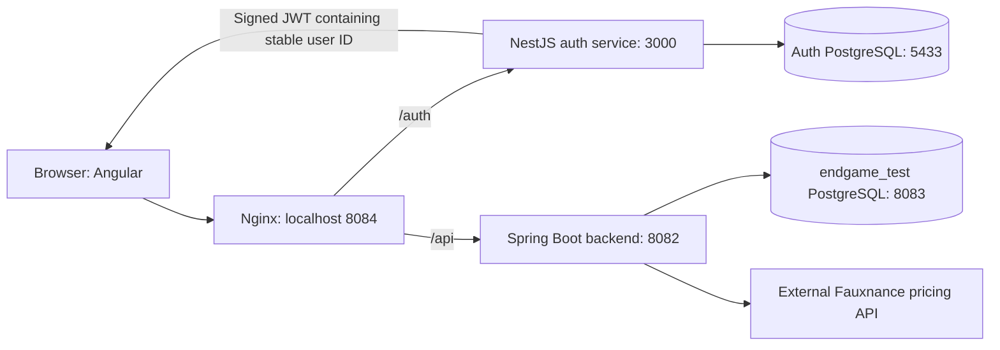
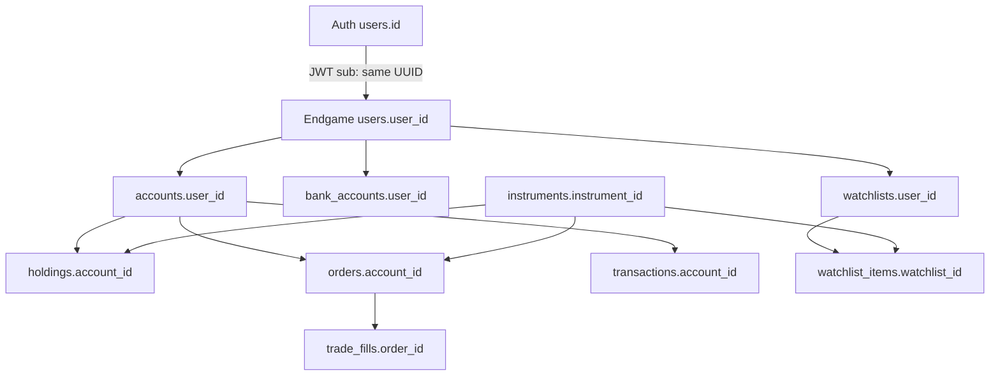
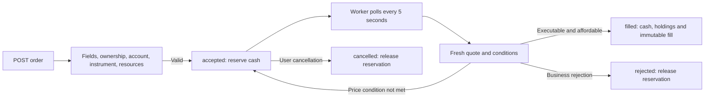

# Asset Avengers: how the project works

This guide describes the current code and database layout as of October 14, 2026.
It separates implemented behavior from planned features. Start here for the whole
project; [order processing](order-processing.md) and
[persistence/API usage](persistence-and-api-usage.md) explain those areas in more detail.

## 1. The overall system

Asset Avengers is a simulated trading application. Users register, log in, add bank
accounts, deposit simulated funds, search instruments, star stocks, and submit orders.
The backend saves account changes in PostgreSQL. It does not send real orders to an
exchange or make real bank transfers.



Nginx makes the browser use one origin. It serves the Angular build and forwards
`/auth/...` to the auth service and `/api/...` to Spring. `docker-compose.yml` defines
these services and both databases. `new-compose.yml` is an obsolete alternative;
use `docker-compose.yml`.

### Repository map

| Location | Responsibility |
| --- | --- |
| `frontend/` | Angular pages, forms, routing, account display, authentication and HTTP calls |
| `auth-server/` | Registration, password verification, access tokens, refresh-token rotation and sessions |
| `backend/` | Account ownership, banking, instruments, orders, execution, holdings, returns and stars |
| `DB/` | Trading/auth SQL schemas, development fixtures, instrument seeds and optional analytics schema |
| `DB/instruments.seed.sql` | Editable source for the 100-ticker catalogue |
| `scripts/` | SQL seed synchronization and isolated PostgreSQL schema/test verification |
| `docs/` | This guide, persistence notes, order behavior and API specifications |
| `UML/` | Earlier class/sequence diagrams; check implementation before treating them as current contracts |
| `Jenkinsfile` | Pull-request checks, environment setup, secret scanning, Docker builds and SonarQube stages |

### Main code entry points

| File or class | Job |
| --- | --- |
| `frontend/src/main.ts`, `app.config.ts` | Bootstrap Angular, configure routes/HTTP, restore authentication |
| Frontend `auth.service.ts`, `auth.interceptor.ts`, `idle.service.ts` | Tokens, shared renewal, logout and idle behavior |
| `client/state/portfolio.store.ts` | Saved-account snapshots, quote refreshes and computed display values |
| `auth-server/src/main.ts`, `app.module.ts`, `app.setup.ts` | Bootstrap Nest, validate configuration, configure parsing/security/Swagger |
| Auth `AuthService`, `UsersRepository`, `SessionsRepository`, `TokenService` | Credential/session workflows and parameterized SQL |
| `EndgameApplication`, `SecurityConfig`, `CurrentUserService` | Bootstrap Spring, verify tokens and resolve the owned account |
| `InstrumentService`, `QuoteCache`, `OrderQuoteService` | Catalogue discovery and cached/fresh pricing |
| `OrderService`, `OrderValidator`, `OrderExecutionWorker`, `OrderExecutionService` | Accept, validate, monitor and atomically execute orders |
| `BankAccountService`, `WatchlistService`, `PositionReturns` | Ledger movements, saved stars and average-cost return calculations |

The current stack is Angular 22/TypeScript, NestJS 12, Spring Boot 4.1.1/Java 25,
and PostgreSQL 18.6. Dependency versions and scripts are defined in the two
`package.json` files and `backend/pom.xml`.

## 2. How the databases identify a client

The auth database assigns a UUID when a user registers. That permanent ID is placed
in the signed JWT's `sub` claim. Spring verifies the token and uses that UUID as
`endgame_test.users.user_id`. It does not trust a browser-provided user ID to choose
whose portfolio to access.

On the first authenticated client request, `CurrentUserService.account` creates the
trading user if absent, locks the user row, and creates a zero-cash account if needed.
Later requests return the existing account. Locking prevents two concurrent first
requests from creating separate accounts.



The databases share the UUID logically. PostgreSQL does not enforce a foreign key
between separate databases. Foreign keys within endgame enforce the relationships
between users, accounts, instruments and financial records.

## 3. What is stored in each database

### Current auth database

| Table | Stored information |
| --- | --- |
| `users` | UUID, email/login name, bcrypt password hash, roles and registration timestamp |
| `sessions` | Login session, user UUID, idle/absolute deadlines and revocation time |
| `refresh_tokens` | SHA-256 hashes of issued refresh tokens and whether they have been used |

Passwords are never stored as plain text. Access JWTs are generated and returned,
not stored as portfolio records. Refresh tokens are stored as hashes, not raw tokens.

**The current auth implementation is not credentials-only:** roles, sessions and
hashed refresh tokens still live there. A strictly credentials-only split would
require a separate migration and corresponding auth-service database changes.
No portfolio, instrument, bank, order or holding data is stored in auth.

### Endgame trading database

| Table | Purpose |
| --- | --- |
| `users` | Trading identity linked to the auth UUID; email, optional name and trading role |
| `accounts` | Saved cash balance, suspension status and update timestamp |
| `bank_accounts` | Bank information entered by the user; UI responses mask account numbers |
| `instruments` | Shared ticker catalogue and verified instruments discovered later |
| `watchlists` | One watchlist per trading user |
| `watchlist_items` | Instruments starred by that user; duplicate stars are prevented |
| `orders` | Order terms, accepted cash commitments, status and rejection/finalization information |
| `trade_fills` | Permanent execution price, quantity and actual rounded cash amount |
| `transactions` | Deposit, withdrawal and dividend ledger events |
| `holdings` | Current quantity per account/instrument; unique account/instrument pair |

SQL constraints prevent negative balances/holdings, invalid enum values, duplicate
symbols, duplicate positions, duplicate stars and multiple fills for one order.
Triggers keep timestamps current, block edits/deletes to ledger and fill records,
and prevent staff users from holding client trading accounts.

The optional `admin_analytics_db.schema.sql` defines reporting tables and views.
It is not connected to the current application and has no implemented data-loading
pipeline. `DB/docker-compose-proddb.yml` similarly defines a separate production
PostgreSQL container; it does not itself install the trading schema.

## 4. Registration, login, logout and reload

`AuthController` maps HTTP routes to `AuthService`. The service uses
`UsersRepository`, `SessionsRepository` and `TokenService`.

1. **Register:** validate email/password, hash the password with bcrypt cost 10,
   insert the credential user, and return the new UUID. Registration does not fund
   an account and does not issue login tokens.
2. **Login:** load credentials, compare the bcrypt hash, create a session, and return
   an access JWT plus a random refresh token. Unknown email and wrong password use
   the same public error; a dummy hash comparison limits timing differences.
3. **Refresh:** hash the supplied refresh token, verify its session/deadlines,
   mark the token used, and issue/store a replacement in one transaction. Reusing
   an already-used token revokes the session.
4. **Logout:** revoke the relevant session and clear browser login state. Financial
   records and stars remain in endgame.

The default access lifetime is 15 minutes, idle session lifetime 30 minutes, and
absolute session lifetime 12 hours. These are configurable environment settings.
An already-issued access JWT remains usable until expiry after logout because
Spring verifies it locally rather than calling the auth service on every request.

Angular's `AuthService` keeps the access token in memory and the refresh token in
per-tab `sessionStorage`. The app initializer restores the session after a reload,
then the client layout loads the same user's saved account. The interceptor attaches
access tokens and shares a single refresh request when requests need renewal.
`IdleService` tracks user input, warns after 13 minutes, and logs out after a further
two minutes unless the user chooses to stay. Background polling is not user activity.

Refreshing a page clears the old Angular display state, then reloads it from the
database. It does not set the saved balance to zero. The permanent user UUID ensures
that logging in again finds the same records.

## 5. Frontend pages and live state

`app.routes.ts` provides login/signup plus client overview, portfolio, orders,
bank accounts and stock search. The client role guard controls navigation;
backend token/ownership checks enforce actual data access.

`PortfolioStore` is the shared client state. Angular signals hold account ID, cash,
holdings, prices, orders and stars. Computed signals derive portfolio value, returns
and allocation. Components read these signals, so a new snapshot updates all
connected screens without reloading the page.

The client layout starts account polling every three seconds and display-price
checks every 15 seconds. Polling stops when the layout is destroyed and pauses while
the document is hidden. Submitting an order or completing a deposit/withdrawal
requests an immediate account refresh. Requests already in flight are not duplicated;
stale responses from an earlier login cannot overwrite a newly signed-in account.

The backend account snapshot reads cash, reservations, holdings, orders and stars
in a repeatable-read transaction. This avoids combining a pre-fill balance with
post-fill holdings in the same display update. Temporary refresh failures retain
the last successful state and retry later.

New users have no holdings or stars. The shared instrument catalogue is selectable
metadata, not a collection of positions assigned to a user. The watchlist's Buy and
Sell buttons each submit one share; Sell is disabled when less than one share is held.
The dialog and stock-search screen submit backend orders rather than browser-only fills.

## 6. Banking and cash available to trade

The banking controller obtains the user from the verified JWT. The service checks
that a bank belongs to that user and loads the user's trading account.

A deposit inserts a `transactions` row and increases `accounts.cash_balance` in a
transaction. A withdrawal locks the account, checks cash after subtracting open-buy
reservations, inserts a withdrawal record, and decreases the balance atomically.
Neither operation contacts a real bank. Success closes the form and refreshes the
saved account; blocking browser success popups have been removed.

`Cash Available to Trade = cash balance − open-buy cash reservations`.
Reserved cash is still part of the account's total cash and portfolio value. It is
unavailable for another buy or withdrawal until the order fills, is cancelled, or
is rejected.

## 7. Instruments, prices and API credits

`DB/instruments.seed.sql` contains 100 starter tickers and is the source of truth.
The test-data fixture is synchronized from that SQL file. The catalogue seed has
stable UUIDs, includes company names from the SEC ticker directory and does not invent prices
or positions. Seed imports preserve instrument IDs and existing descriptive names,
and replace ticker-only placeholder names with the catalogue company name. BRK.B is represented as BRK-B for pricing lookup.

An existing instrument lookup reads metadata from endgame. An unknown ticker is
normalized and verified against a valid provider quote before an atomic insert.
The symbol's unique constraint prevents duplicate records during concurrent lookups.
Direct trading by a previously unknown symbol uses the same discovery service.
Discovery commits independently, so verified metadata remains available even if a
later order fails for insufficient cash/shares. Invalid pricing creates no fake ticker.

`QuoteCache` shares display quotes by symbol across clients for 60 seconds by default,
with a maximum of 512 cached symbols. Catalogue loading makes no quote requests;
only held/starred stocks, explicit searches and orders require pricing. Display-price
polling uses this cache, and pending limit/stop orders use it for monitoring.

Market-buy validation and actual execution deliberately fetch again rather than
relying on a display quote. When a cached price suggests a limit/stop may execute,
the worker fetches a fresh quote and rechecks before changing balances. This limits
paid requests while keeping execution tied to the provider's latest available data.
The simulator accepts the provider's latest cached or closing quote even when
`stale: true`, after fetching from the provider again. This retrieves the latest
available provider price, which may still be an older closing price. Invalid prices,
missing timestamps, mismatched symbols/currencies and far-future timestamps cannot
execute. Quote age and the stale flag alone do not prevent simulated trades.

## 8. Order lifecycle

Controllers receive JSON DTOs. Services enforce business rules. Repositories load
and save entities through JPA. SQL constraints provide an additional integrity layer.



Market, limit, stop and stop-limit orders are supported by the backend. The standard
client trade controls submit market orders. Buys use ask and sells use bid.
Orders fill their entire quantity; there is no order-book matching or partial-fill engine.

The account lock serializes competing commitments. Order locks prevent duplicate
execution or conflicting updates. Execution changes cash, holdings, order status
and the fill record in one transaction. Pricing/transient database failures leave
accepted orders available for retry; business failures record a rejection reason.

Prices/quantities support four decimal places. Cash supports cents. Buy debits and
reservations round up; sell credits round down. Only USD settlement is implemented.
The frontend currently requests whole-share trades even though backend quantity
validation supports fractional shares.

## 9. Value, total return and allocation

- **Portfolio value:** full cash balance plus each holding's quantity × latest market price.
- **Unrealized return:** quantity × (market price − average purchase cost).
- **Realized return:** sale proceeds minus the average cost basis of shares sold.
- **Total return:** realized plus unrealized return from recorded trade histories.
- **Allocation:** holding market values and the full cash balance as percentages of their total.

Average cost and realized results are derived from immutable fill quantities and
actual rounded cash amounts. Positions imported without purchase history have
unknown cost basis: their market value counts, but their return is excluded and
shown as unavailable. Deposits are not profit.

The performance card shows actual current value and return. The earlier fabricated
history and benchmark have been removed. Historical portfolio valuation snapshots
are not currently recorded, so there is no genuine historical performance chart yet.

### Error handling

Validation failures return 400 with a readable detail. Missing/expired authentication
returns 401; the browser can try one shared token refresh. Wrong ownership/role returns
403. Missing resources return 404, pricing failures return 502, and unexpected server
errors return 500. The trade confirmation and watchlist show server details inline.
`OrderExceptionHandler` preserves explicit HTTP statuses instead of converting every
exception into a 500. Auth's `ApiErrorFilter` produces its consistent JSON error shape.

## 10. Implemented API map

| Route | Purpose |
| --- | --- |
| `POST /auth/register`, `/login`, `/refresh`, `/logout` | Credential/session lifecycle |
| `GET /health/live`, `/health/ready` on auth service | Process/database readiness |
| `POST /api/v1/me/accounts` | Create or restore the authenticated client's account |
| `GET /api/v1/bank-accounts/trading-account` | Authenticated account snapshot |
| `GET/POST /api/v1/bank-accounts` | List/add the signed-in user's banks |
| `DELETE /api/v1/bank-accounts/{id}` | Remove an owned bank |
| `POST /api/v1/bank-accounts/deposit`, `/withdraw` | Simulated ledger movements |
| `GET /api/v1/instruments`, `/{symbol}` | Catalogue and verified discovery |
| `POST /api/v1/instruments` | Manual instrument metadata creation |
| `GET /api/v1/orders/quote/symbol/{symbol}`, `/quote/{instrumentId}` | Display quotes through the shared cache |
| `GET/POST /api/v1/orders` | Owned order history and order submission |
| `GET/PATCH /api/v1/orders/{id}` | Read an owned order / change its limit or stop price |
| `PATCH /api/v1/orders/{id}/cancel` | Cancel an owned open order |
| `PUT/DELETE /api/v1/me/watchlist/{symbol}` | Persist or remove a star |

Swagger is available on auth at `http://localhost:3000/api` and Spring at
`http://localhost:8082/swagger-ui/index.html`. The YAML API documents include broader
planned features; current controller code is authoritative for implemented routes.
The older holdings controller is profile-gated and does not supply the client
portfolio: the account snapshot is the current source.

## 11. Database schemas, seeds and persistence

| File | Role |
| --- | --- |
| `DB/endgame_db.schema.sql` | Idempotent trading DDL, upgrades, indexes and triggers |
| `DB/endgame_db_test_data.sql` | Synchronized copy of the canonical catalogue for setup/schema verification |
| `DB/instruments.seed.sql` | Editable source of truth; Compose initialization and manual catalogue imports |
| `DB/auth_db.schema.sql` | Current credential/session/refresh-token DDL |
| `DB/auth_db_test_data.sql` | Eight development login fixtures; no trading positions |
| `DB/admin_analytics_db.schema.sql` | Optional reporting design, not runtime app storage |

Auth login fixtures are for local/CI testing, not production accounts. Fresh endgame
seeding adds 100 instruments and zero users, accounts, banks, orders, holdings or stars.
Existing runtime records are preserved by the non-reset seed/update process.

Docker Compose mounts the trading schema followed by the canonical SQL seed into
PostgreSQL's initialization directory. It mounts the separate auth schema and auth
fixtures into the auth database. The two persistent storage locations stay separate.
The frontend waits for the auth service's readiness health check; the backend and
auth service each wait for their own database health check.

PostgreSQL initialization scripts run only when the database volume is empty.
Editing a mounted SQL file or restarting an app container does not automatically
migrate an existing database. Apply approved schema updates explicitly.
`setup-test-db.sh` applies current trading SQL/seed files without resetting data by
default and reuses the Compose database if present. Its explicit `--reset` option
deletes/recreates that database; it is not a normal refresh step.

The trading container uses the host-mounted `~/.asset_postgres_test_data` directory;
auth uses the `auth_db_data` Docker volume. Rebuilding/restarting backend, frontend
or auth-server does not erase those databases. Deleting database storage or explicitly
resetting the database does.

## 12. Development and verification

Use the repo-root `.env.example` as the configuration checklist and keep actual
credentials/API keys in the untracked `.env`. Do not put secrets into documentation.
Configure the same JWT secret in auth and Spring. Use Java 25 for backend builds.

```bash
# Build/start the local stack; frontend is http://localhost:8084.
docker compose up -d --build

# Confirm the test-data fixture matches the canonical SQL seed.
python3 scripts/generate-instrument-seed.py --check

# After editing DB/instruments.seed.sql, synchronize the test-data fixture.
python3 scripts/generate-instrument-seed.py

# Verify SQL/seed reruns in disposable databases and compare live structure.
python3 scripts/verify-db-schemas.py --check-live

# Test Java entities against real SQL constraints in a disposable PostgreSQL DB.
python3 scripts/run-backend-postgres-tests.py
```

### How the helper scripts work

- `scripts/instrument_seed.py` reads `DB/instruments.seed.sql` and checks ticker
  syntax, duplicate symbols, valid UUIDs and duplicate UUIDs. SQL validity is checked
  separately by loading the seed into PostgreSQL.
- `scripts/generate-instrument-seed.py` copies that SQL unchanged into
  `DB/endgame_db_test_data.sql`. Despite the existing filename, it synchronizes a
  fixture; it does not generate instrument metadata, fetch quotes or connect to a
  database. `--check` validates the source and checks file equality without writing.
- `scripts/verify-db-schemas.py` creates disposable PostgreSQL databases, applies
  schemas and fixtures twice to check reruns, and checks row counts and empty trading
  portfolios. `--check-live` also reads live columns/defaults/constraints and compares
  them with the canonical schemas. It deletes only its own temporary databases.
- `scripts/run-backend-postgres-tests.py` loads the actual trading schema into its
  own temporary database and runs Maven with Hibernate schema validation and small
  connection pools. It removes its temporary database afterward.
- `setup-test-db.sh` checks that the seed fixture is synchronized and applies the
  trading schema and fixture to the existing local database. Unlike the verification
  helpers, this intentionally updates the app database. Without `--reset`, existing
  account records remain intact and seed conflicts preserve existing instruments.

After editing the canonical seed, synchronize the fixture before running setup or
committing. A normal restart does not import new seed rows into existing storage.

The PostgreSQL runner requires a running `endgame_postgres` container, its host port
8083, Maven and Java 25. `--container`, `--port` and `--java-home` support other setups.
It uses smaller test pools to avoid exhausting the live server's connection limit.
Its temporary database is removed afterward; it does not reset `endgame_test`.

For standard backend tests, use a test-only JWT secret and run `mvn test` from
`backend/`. Tests use H2 by default, mock pricing, and disable scheduled execution.
Auth tests use `npm test` and `npm run test:e2e` from `auth-server/`. Frontend uses
`npm test -- --watch=false` and `npm run build` from `frontend/` after installing its
locked dependencies. Auth shell integration scripts also touch persistent local test
data and should be read before use.

## 13. Current limits and unfinished areas

There is no real banking/exchange integration, FX conversion, fee model, partial
liquidity or genuine historical performance series. SQL analytics tables have no
connected ingestion pipeline. Some earlier UML/YAML/setup notes describe planned
features rather than current behavior.

The current instrument routes include a public manual-create endpoint, and privileged
user/admin APIs need stricter role checks before a production deployment. Bank account
numbers are stored directly in the database and masked only in API responses; production
encryption is not implemented. These are current code limits, not completed features.

The current JWT decoder verifies the shared-secret signature and standard time validity;
explicit Spring issuer/audience validators are not yet wired into the decoder.
The credentials-only auth database proposal remains a separate architectural change.

## 14. Verification completed for this guide

On October 14, 2026, the trading, auth and analytics SQL schemas were loaded twice
into disposable PostgreSQL databases. The test-data fixture matched the canonical SQL seed
containing 100 symbols. Trading startup contained 100 instruments and no seeded portfolios;
auth startup contained its eight development credential fixtures and no sessions.
Live auth/endgame columns, defaults and constraints matched the canonical schemas.
The full 101-test backend suite passed against the actual PostgreSQL SQL schema with
Hibernate validation, including the append-only fill-trigger check. Temporary test
databases were cleaned up and live user records were not reset.

The quote-policy regression checks cover simulated buys and sells using newly fetched
provider quotes marked stale, including older closing prices. Future timestamps still
fail validation. Submission and execution fetch independently so a changed execution
price updates the actual fill and cash amount.

## 15. Company-name search

Market watch, Search & Trade and the trade dialog match saved instrument names and ticker symbols,
ignoring case and punctuation. Familiar aliases include Google for Alphabet's two
share classes and Facebook for Meta. Market watch displays matching stocks that can
be starred; Search & Trade displays matching company/ticker choices before requesting
a quote for the selected stock. It never guesses one share class when several match.

The 100 starter catalogue names come from the [SEC company ticker directory](https://www.sec.gov/files/company_tickers.json).
The legacy SQ entry remains in the catalogue; a valid provider quote is still required
to trade it. Name matching uses the saved catalogue and makes no paid pricing requests.
Companies outside this catalogue still need ticker lookup; newly discovered instruments
have ticker-only names until descriptive metadata is supplied. This is not a global
company search service. Seed imports update placeholder names without changing holdings,
orders, cash, stars or existing descriptive instrument names.

Company-search verification: all 39 frontend tests passed, including selection
between Google share classes, unknown-company handling and Walmart lookup inside
the trade dialog. The Angular production
build passed. The updated SQL seed passed PostgreSQL schema/fixture rerun checks.
