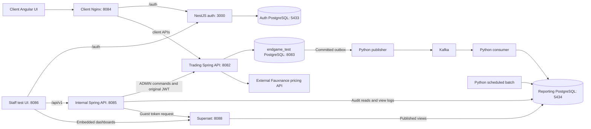
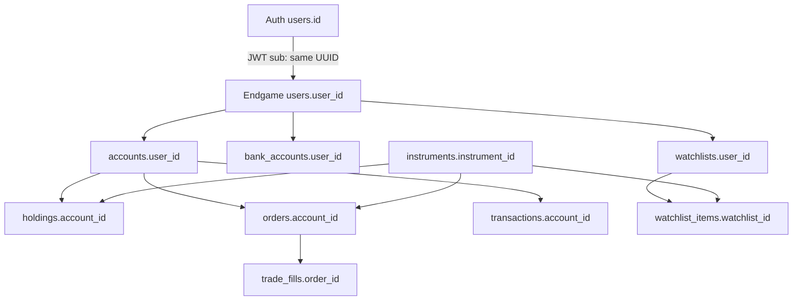
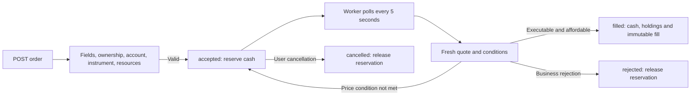

# Asset Avengers: how the project works

This guide describes the whole project as of October 19, 2026: client trading,
shared authentication, the separate admin/analyst services, and their databases.
The [Spring Boot review](spring-boot-review.md) describes the latest Java cleanup
and remaining framework improvements.
Read the [code map](code-map.md) to locate each implementation and the
[design decisions](design-decisions.md) for why the pieces are separated this way.
The [database reference](../DB/README.md) covers every schema, table family,
trigger, seed and database helper. More detail is available in
[order processing](order-processing.md), [persistence/API usage](persistence-and-api-usage.md)
and the [staff setup guide](admin-analytics/setup.md).

## Required authenticator MFA and password reset

All client, Ultron and Friday identities must complete authenticator setup before
receiving a session. Signup automatically opens the QR setup component, with
instructions for Google Authenticator, Microsoft Authenticator or another compatible
app. Existing unenrolled demo accounts do the same on their next login. Future
logins require password plus authenticator/recovery code; logout has no grace period.
Valid refresh sessions do not repeatedly prompt. Authenticator replacement proves
the old and new factors; removal is blocked.

Signup email verification is intentionally off for dummy-email testing. **Forgot
password?** emails a short-lived, single-use reset code through Resend using the
server-only root `Email_Service` key. Code verification must succeed before the new
password form appears. The server rejects reuse of the current password. A reset changes the password and revokes refresh
sessions; it never disables MFA or logs the user in. Real delivery needs a permitted
recipient and sender; dummy addresses do not receive real email.

Auth adds `user_mfa`, `mfa_challenges`, `mfa_recovery_codes`,
`password_reset_requests`, `auth_email_outbox` and `sessions.mfa_verified_at`.
`start-project.sh --all` applies the updated schema to saved volumes. Old password-only
sessions cannot refresh, and both Spring APIs reject JWTs without the signed
`amr: ["pwd", "mfa"]` claim. Keep the root `MFA_ENCRYPTION_KEY` stable; it and
`Email_Service` are passed only to auth. Financial schemas and saved portfolios
are unaffected. See [MFA examples](mfa.md) and [email/reset behavior](email-service.md).

## 1. The overall system

Asset Avengers is a simulated trading application. Users register, log in, add bank
accounts, deposit simulated funds, search instruments, star stocks, and submit orders.
The backend saves account changes in PostgreSQL. It does not send real orders to an
exchange or make real bank transfers.



Each UI's Nginx makes its auth and API calls use one browser origin. The client
stack is `docker-compose.yml`; the staff stack is
`deployment/admin-analytics/admin-analyst-stack.compose.yml`. Start both to use all features. The staff
stack joins the root stack's `trading_platform_network` to reach auth and trading.
Its reporting database and Kafka also use its own network. `new-compose.yml` is
an obsolete alternative, not a second required stack.

Admin and analyst APIs share one internal deployable service with different role
checks. Client trading stays in its own backend. The staff backend reads reporting
copies and forwards commands to the trading API; only the trading API changes
authoritative cash, holdings and suspension state. This avoids two services
independently enforcing the same business rules.

### Repository map

| Location | Responsibility |
| --- | --- |
| `frontend/` | Angular pages, forms, routing, account display, authentication and HTTP calls |
| `auth-server/` | Registration, password verification, access tokens, refresh-token rotation and sessions |
| `backend/` | Account ownership, banking, instruments, orders, execution, holdings, returns and stars |
| `internal-backend/` | Independent admin and analyst API; packages for admin, analytics, security and common code |
| `internal-frontend/` | Simple separate staff test console, including audit lookups and embedded reports |
| `admin-analytics/` | Staff data pipeline, nightly reporting and Superset configuration |
| `deployment/admin-analytics/` | Separate staff Docker Compose stack; settings come from root `.env` |
| `DB/` | Trading/auth/reporting SQL schemas, development fixtures and instrument seeds |
| `DB/instruments.seed.sql` | Editable source for the 100-ticker catalogue |
| `scripts/` | SQL seed synchronization and isolated PostgreSQL schema/test verification |
| `docs/` | This guide, persistence notes, order behavior and API specifications |
| `UML/` | Earlier class/sequence diagrams; check implementation before treating them as current contracts |
| `Jenkinsfile` | Pull-request checks, environment setup, secret scanning, Docker builds and SonarQube stages |

### Understanding the staff folder names

`internal-backend` and `internal-frontend` mean staff-facing services shared by
admins and analysts. `admin-analytics` holds Python reporting jobs and Superset
configuration. `deployment/admin-analytics` holds deployment instructions that run those
pieces together, not another copy of their application code. Its `admin-analyst-stack.compose.yml`
defines containers, configuration, ports, networks and persistent volumes.

The root `docker-compose.yml` starts the client/trading/auth stack; the staff
`deployment/admin-analytics/admin-analyst-stack.compose.yml` starts the separate staff/reporting stack.
Start the root stack first, then the staff stack to use both interfaces. See the
[Docker folder guide](../deployment/README.md) for commands and the
[reporting infrastructure guide](../admin-analytics/README.md) for the Python/Superset code.

### Main code entry points

| File or class | Job |
| --- | --- |
| `frontend/src/main.ts`, `app.config.ts` | Bootstrap Angular, configure routes/HTTP, restore authentication |
| Frontend `auth.service.ts`, `auth.interceptor.ts`, `idle.service.ts` | Tokens, shared renewal, logout and idle behavior |
| `client/state/portfolio.store.ts` | Saved-account snapshots, quote refreshes and computed display values |
| `auth-server/src/main.ts`, `app.module.ts`, `app.setup.ts` | Bootstrap Nest, validate configuration, configure parsing/security/Swagger |
| Auth `AuthService`, `UsersRepository`, `SessionsRepository`, `TokenService` | Credential/session workflows and parameterized SQL |
| `EndgameApplication`, `SecurityConfig`, `CurrentUserService` | Bootstrap Spring, verify tokens and resolve the owned account |
| `InstrumentService`, `QuoteCache`, `OrderQuoteService` | Catalogue discovery and cached/fresh pricing |
| `OrderService`, `OrderValidator`, `OrderExecutionWorker`, `OrderExecutionService` | Accept, validate, monitor and atomically execute orders |
| `BankAccountService`, `WatchlistService`, `PositionReturns` | Ledger movements, saved stars and average-cost return calculations |

The checked-in manifests use Angular 22/TypeScript, NestJS 12, Spring Boot 4.1.1/
Java 25, PostgreSQL 18.6, Kafka 4.1.2 and Superset 6.0.0. The staff test UI uses
plain JavaScript with Vite and the Superset embedding SDK. Each Node project has
its own `package.json`/lockfile; each Java backend has its own `pom.xml`.
The root Maven reactor can build both Java projects without creating a dependency
between their application code.

## 2. How the databases identify a client

The auth database assigns a UUID when a user registers. That permanent ID is placed
in the signed JWT's `sub` claim. Spring verifies the token and uses that UUID as
`endgame_test.users.user_id`. It does not trust a browser-provided user ID to choose
whose portfolio to access.

On the first authenticated client request, `CurrentUserService.account` creates the
trading user if absent, locks the user row, and creates a zero-cash account if needed.
Later requests return the existing account. Locking prevents two concurrent first
requests from creating separate accounts.



The databases share the UUID logically. PostgreSQL does not enforce a foreign key
between separate databases. Foreign keys within endgame enforce the relationships
between users, accounts, instruments and financial records.

## 3. What is stored in each database

### Current auth database

| Table | Stored information |
| --- | --- |
| `users` | UUID, email, first/last names, bcrypt password hash, roles and registration timestamp |
| `sessions` | Login session, user UUID, idle/absolute deadlines, revocation time and `mfa_verified_at` |
| `user_mfa` | Encrypted authenticator secret, enabled timestamp, replay step and failed-attempt lockout |
| `mfa_challenges` | Hashed temporary MFA/setup/replacement tokens, attempts/expiry and encrypted pending replacement secret |
| `mfa_recovery_codes` | Hashed one-use recovery codes and use timestamps |
| `password_reset_requests` | Hashed reset token, HMAC-protected email code, user UUID, expiry and attempts |
| `auth_email_outbox` | Encrypted reset delivery payload, retry/lease state and Resend email ID |
| `refresh_tokens` | SHA-256 hashes of issued refresh tokens and whether they have been used |

Passwords are never stored as plain text. Access JWTs are generated and returned,
not stored as portfolio records. Refresh tokens are stored as hashes, not raw tokens.

**The current auth implementation is not credentials-only:** roles, sessions and
hashed refresh tokens still live there. A strictly credentials-only split would
require a separate migration and corresponding auth-service database changes.
No portfolio, instrument, bank, order or holding data is stored in auth.

### Endgame trading database

| Table | Purpose |
| --- | --- |
| `users` | Trading identity linked to the auth UUID; email, optional name and trading role |
| `accounts` | Saved cash balance, suspension status and update timestamp |
| `bank_accounts` | Bank information entered by the user; UI responses mask account numbers |
| `instruments` | Shared ticker catalogue and verified instruments discovered later |
| `watchlists` | One watchlist per trading user |
| `watchlist_items` | Instruments starred by that user; duplicate stars are prevented |
| `orders` | Order terms, accepted cash commitments, status and rejection/finalization information |
| `trade_fills` | Permanent execution price, quantity and actual rounded cash amount |
| `transactions` | Deposit, withdrawal and dividend ledger events |
| `holdings` | Current quantity per account/instrument; unique account/instrument pair |
| `order_audit_events` | Submitted, terminal rejection and filled lifecycle facts |
| `order_pricing_evidence` | The quote actually used, its phase and validation outcome |
| `cash_ledger` | Signed movements linked to the original fill or banking transaction |
| `staff_audit_events` | Authoritative staff commands recorded with the trading change |
| `audit_outbox` | Committed source changes waiting for delivery to Kafka |

SQL constraints prevent negative balances/holdings, invalid enum values, duplicate
symbols, duplicate positions, duplicate stars and multiple fills for one order.
Triggers keep timestamps current, block edits/deletes to ledger and fill records,
and prevent staff users from holding client trading accounts.

The `admin_analytics_db.schema.sql` defines the separate staff reporting store.
The Kafka/Python pipeline and `internal-backend/` use it; see the
[staff architecture](admin-analytics/architecture.md).
`DB/docker-compose-proddb.yml` defines a separate production
PostgreSQL container; it does not itself install the trading schema.

### Staff reporting and Superset metadata

The reporting store keeps current account/instrument/position copies, immutable
order facts and movements, original envelopes and pricing evidence. The
`integration` schema tracks freshness, batch attempts, published report versions
and approved dashboard IDs. `analytics` contains facts for each batch and views
that expose only published batches. Existing `reporting.*` compatibility views
read copied lifecycle facts directly; they are not the scheduled publication
contract. Monthly segmentation remains a schema-only proposal.

Superset's own database stores users, roles, chart definitions and dashboard
layouts. It is a separate database on the reporting PostgreSQL instance. Its
restricted reporting connection reads approved views in the reporting database;
it does not connect to the trading or authentication database. See the
[database reference](../DB/README.md) for exact writers and readers.

## 4. Registration, login, logout and reload

`AuthController` maps HTTP routes to `AuthService`. The service uses
`UsersRepository`, `SessionsRepository`, `TokenService` and `MfaService`.
`PasswordResetService` owns separate email reset challenges and delivery jobs.

1. **Register:** validate first/last names and email/password, hash the password with bcrypt cost 10,
   insert the credential user, and return the new UUID. Registration does not fund
   an account and does not issue login tokens.
2. **Login:** compare the bcrypt hash, then return mandatory authenticator setup
   or a code challenge. Successful authenticator/recovery proof creates the session
   and returns the access JWT/refresh token. Enrollment also returns recovery codes.
   Unknown email and wrong password use the same public error; a dummy hash comparison
   limits timing differences. Spring requires the signed `amr` claim to include MFA.
3. **Refresh:** hash the supplied refresh token, verify its MFA session/deadlines,
   mark the token used, and issue/store a replacement in one transaction. Reusing
   an already-used token revokes the session.
4. **Logout:** revoke the relevant session and clear browser login state. Financial
   records and stars remain in endgame. A new login requires MFA again.
5. **Forgot password:** write an expiring email-code challenge and encrypted auth
   email job. Resend delivery runs in the background. Email-code verification issues a five-minute grant before password fields appear.
   A grant-authorized reset rejects the current password, changes the password, revokes refresh sessions and invalidates pending challenges, preserving
   the authenticator. Email verification at signup stays off for testing.

The default access lifetime is 15 minutes, idle session lifetime 30 minutes, and
absolute session lifetime 12 hours. These are configurable environment settings.
An already-issued access JWT remains usable until expiry after logout because
Spring verifies it locally rather than calling the auth service on every request.

Angular's `AuthService` keeps the access token in memory and the refresh token in
per-tab `sessionStorage`. The app initializer restores the session after a reload,
then the client layout loads the same user's saved account. The interceptor attaches
access tokens and shares a single refresh request when requests need renewal.
`IdleService` tracks user input, warns after 13 minutes, and logs out after a further
two minutes unless the user chooses to stay. Background polling is not user activity.

Refreshing a page clears the old Angular display state, then reloads it from the
database. It does not set the saved balance to zero. The permanent user UUID ensures
that logging in again finds the same records.

## 5. Frontend pages and live state

`app.routes.ts` provides login/signup plus client overview, portfolio, orders,
bank accounts and stock search. The client role guard controls navigation;
backend token/ownership checks enforce actual data access.

`PortfolioStore` is the shared client state. Angular signals hold account ID, cash,
holdings, prices, orders and stars. Computed signals derive portfolio value, returns
and allocation. Components read these signals, so a new snapshot updates all
connected screens without reloading the page.

The client layout starts account polling every three seconds and display-price
checks every 15 seconds. Polling stops when the layout is destroyed and pauses while
the document is hidden. Submitting an order or completing a deposit/withdrawal
requests an immediate account refresh. Requests already in flight are not duplicated;
stale responses from an earlier login cannot overwrite a newly signed-in account.

The backend account snapshot reads cash, reservations, holdings, orders and stars
in a repeatable-read transaction. This avoids combining a pre-fill balance with
post-fill holdings in the same display update. Temporary refresh failures retain
the last successful state and retry later.

New users have no holdings or stars. The shared instrument catalogue is selectable
metadata, not a collection of positions assigned to a user. The watchlist's Buy and
Sell buttons each submit one share; Sell is disabled when less than one share is held.
The dialog and stock-search screen submit backend orders rather than browser-only fills.

## 6. Banking and cash available to trade

The banking controller obtains the user from the verified JWT. The service checks
that a bank belongs to that user and loads the user's trading account.

A deposit inserts a `transactions` row and increases `accounts.cash_balance` in a
transaction. A withdrawal locks the account, checks cash after subtracting open-buy
reservations, inserts a withdrawal record, and decreases the balance atomically.
Neither operation contacts a real bank. Success closes the form and refreshes the
saved account; blocking browser success popups have been removed.

`Cash Available to Trade = cash balance − open-buy cash reservations`.
Reserved cash is still part of the account's total cash and portfolio value. It is
unavailable for another buy or withdrawal until the order fills, is cancelled, or
is rejected.

## 7. Instruments, prices and API credits

`DB/instruments.seed.sql` contains 100 starter tickers and is the source of truth.
The test-data fixture is synchronized from that SQL file. The catalogue seed has
stable UUIDs, includes company names from the SEC ticker directory and does not invent prices
or positions. Seed imports preserve instrument IDs and existing descriptive names,
and replace ticker-only placeholder names with the catalogue company name. BRK.B is represented as BRK-B for pricing lookup.

An existing instrument lookup reads metadata from endgame. An unknown ticker is
normalized and verified against a valid provider quote before an atomic insert.
The symbol's unique constraint prevents duplicate records during concurrent lookups.
Direct trading by a previously unknown symbol uses the same discovery service.
Discovery commits independently, so verified metadata remains available even if a
later order fails for insufficient cash/shares. Invalid pricing creates no fake ticker.

`QuoteCache` shares display quotes by symbol across clients for 60 seconds by default,
with a maximum of 512 cached symbols. Catalogue loading makes no quote requests;
only held/starred stocks, explicit searches and orders require pricing. Display-price
polling uses this cache, and pending limit/stop orders use it for monitoring.

Market-buy validation and actual execution deliberately fetch again rather than
relying on a display quote. When a cached price suggests a limit/stop may execute,
the worker fetches a fresh quote and rechecks before changing balances. This limits
paid requests while keeping execution tied to the provider's latest available data.
The simulator accepts the provider's latest cached or closing quote even when
`stale: true`, after fetching from the provider again. This retrieves the latest
available provider price, which may still be an older closing price. Invalid prices,
missing timestamps, mismatched symbols/currencies and far-future timestamps cannot
execute. Quote age and the stale flag alone do not prevent simulated trades.

## 8. Order lifecycle

Controllers receive JSON DTOs. Services enforce business rules. Repositories load
and save entities through JPA. SQL constraints provide an additional integrity layer.



Market, limit, stop and stop-limit orders are supported by the backend. The standard
client trade controls submit market orders. Buys use ask and sells use bid.
Orders fill their entire quantity; there is no order-book matching or partial-fill engine.

The account lock serializes competing commitments. Order locks prevent duplicate
execution or conflicting updates. Execution changes cash, holdings, order status
and the fill record in one transaction. Pricing/transient database failures leave
accepted orders available for retry; business failures record a rejection reason.

Prices/quantities support four decimal places. Cash supports cents. Buy debits and
reservations round up; sell credits round down. Only USD settlement is implemented.
The trade dialog accepts fractional buys and sells from 0.0001 shares, with up to
four decimal places. For example, enter 0.25 to trade a quarter share. Watchlist
quick-trade buttons submit one share; open the trade dialog for a custom quantity.

## 9. Value, total return and allocation

- **Portfolio value:** full cash balance plus each holding's quantity × latest market price.
- **Unrealized return:** quantity × (market price − average purchase cost).
- **Realized return:** sale proceeds minus the average cost basis of shares sold.
- **Total return:** realized plus unrealized return from recorded trade histories.
- **Allocation:** holding market values and the full cash balance as percentages of their total.

Average cost and realized results are derived from immutable fill quantities and
actual rounded cash amounts. Positions imported without purchase history have
unknown cost basis: their market value counts, but their return is excluded and
shown as unavailable. Deposits are not profit.

The performance card shows actual current value and return, plus a Chart.js line
of real observations collected while the Overview page is open (every 15 seconds
and when the value changes). Observations reset on navigation/reload and are capped
at 240 points. The line includes cash flows and is not a return percentage.
Historical portfolio valuation snapshots are not persisted; no historical or
benchmark values are generated.

### Error handling

Validation failures return 400 with a readable detail. Missing/expired authentication
returns 401; the browser can try one shared token refresh. Wrong ownership/role returns
403. Missing resources return 404, pricing failures return 502, and unexpected server
errors return 500. The trade confirmation and watchlist show server details inline.
`OrderExceptionHandler` preserves explicit HTTP statuses instead of converting every
exception into a 500. Auth's `ApiErrorFilter` produces its consistent JSON error shape.

## 10. Implemented API map

| Route | Purpose |
| --- | --- |
| `POST /auth/register`, `/login`, `/refresh`, `/logout` | Credentials, mandatory MFA challenge and session lifecycle |
| `POST /auth/mfa/enable`, `/verify`, `/replace/*` | Required enrollment, login proof and authenticator replacement |
| `POST /auth/forgot-password`, `/verify-reset-code`, `/reset-password` | Request code, verify it, then choose a different password; preserves MFA |
| `GET /health/live`, `/health/ready` on auth service | Process/database readiness |
| `POST /api/v1/me/accounts` | Create or restore the authenticated client's account |
| `GET /api/v1/bank-accounts/trading-account` | Authenticated account snapshot |
| `GET/POST /api/v1/bank-accounts` | List/add the signed-in user's banks |
| `DELETE /api/v1/bank-accounts/{id}` | Remove an owned bank |
| `POST /api/v1/bank-accounts/deposit`, `/withdraw` | Simulated ledger movements |
| `GET /api/v1/instruments`, `/{symbol}` | Catalogue and verified discovery |
| `POST /api/v1/instruments` | Manual instrument metadata creation |
| `GET /api/v1/orders/quote/symbol/{symbol}`, `/quote/{instrumentId}` | Display quotes through the shared cache |
| `GET/POST /api/v1/orders` | Owned order history and order submission |
| `GET/PATCH /api/v1/orders/{id}` | Read an owned order / change its limit or stop price |
| `PATCH /api/v1/orders/{id}/cancel` | Cancel an owned open order |
| `PUT/DELETE /api/v1/me/watchlist/{symbol}` | Persist or remove a star |

Swagger is available on auth at `http://localhost:3000/api` and Spring at
`http://localhost:8082/swagger-ui/index.html`. The YAML API documents include broader
planned features; current controller code is authoritative for implemented routes.
The older holdings controller is profile-gated and does not supply the client
portfolio: the account snapshot is the current source.

## 11. Database schemas, seeds and persistence

| File | Role |
| --- | --- |
| `DB/endgame_db.schema.sql` | Idempotent trading DDL, upgrades, indexes and triggers |
| `DB/endgame_db_test_data.sql` | Synchronized copy of the canonical catalogue for setup/schema verification |
| `DB/instruments.seed.sql` | Editable source of truth; Compose initialization and manual catalogue imports |
| `DB/auth_db.schema.sql` | Current credential/session/refresh-token DDL |
| `DB/auth_db_test_data.sql` | Eight development login fixtures; no trading positions |
| `DB/admin_analytics_db.schema.sql` | Reporting/audit store used by the separate admin/analyst stack |

Auth login fixtures are for local/CI testing, not production accounts. Fresh endgame
seeding adds 100 instruments and zero users, accounts, banks, orders, holdings or stars.
Existing runtime records are preserved by the non-reset seed/update process.

Docker Compose mounts the trading schema followed by the canonical SQL seed into
PostgreSQL's initialization directory. It mounts the separate auth schema and auth
fixtures into the auth database. The two persistent storage locations stay separate.
The frontend waits for the auth service's readiness health check; the backend and
auth service each wait for their own database health check.

PostgreSQL initialization scripts run only when the database volume is empty.
Editing a mounted SQL file or restarting an app container does not automatically
migrate an existing database. Apply approved schema updates explicitly.
`setup-test-db.sh` applies current trading SQL/seed files without resetting data by
default and reuses the Compose database if present. Its explicit `--reset` option
deletes/recreates that database; it is not a normal refresh step.

The trading container uses the host-mounted `~/.asset_postgres_test_data` directory;
auth uses the `auth_db_data` Docker volume. Rebuilding/restarting backend, frontend
or auth-server does not erase those databases. Deleting database storage or explicitly
resetting the database does.

## 12. Development and verification

Use the repo-root `.env.example` as the configuration checklist and keep actual
credentials/API keys in the untracked `.env`. Do not put secrets into documentation.
Configure the same JWT secret in auth and Spring. Use Java 25 for backend builds.

```bash
# Build/start the local stack; frontend is http://localhost:8084.
docker compose up -d --build

# Confirm the test-data fixture matches the canonical SQL seed.
python3 scripts/generate-instrument-seed.py --check

# After editing DB/instruments.seed.sql, synchronize the test-data fixture.
python3 scripts/generate-instrument-seed.py

# Verify SQL/seed reruns in disposable databases and compare live structure.
python3 scripts/verify-db-schemas.py --check-live

# Test Java entities against real SQL constraints in a disposable PostgreSQL DB.
python3 scripts/run-backend-postgres-tests.py
```

### How the helper scripts work

- `scripts/instrument_seed.py` reads `DB/instruments.seed.sql` and checks ticker
  syntax, duplicate symbols, valid UUIDs and duplicate UUIDs. SQL validity is checked
  separately by loading the seed into PostgreSQL.
- `scripts/generate-instrument-seed.py` copies that SQL unchanged into
  `DB/endgame_db_test_data.sql`. Despite the existing filename, it synchronizes a
  fixture; it does not generate instrument metadata, fetch quotes or connect to a
  database. `--check` validates the source and checks file equality without writing.
- `scripts/verify-db-schemas.py` creates disposable PostgreSQL databases, applies
  schemas and fixtures twice to check reruns, and checks row counts and empty trading
  portfolios. `--check-live` also reads live columns/defaults/constraints and compares
  them with the canonical schemas. It deletes only its own temporary databases.
- `scripts/run-backend-postgres-tests.py` loads the actual trading schema into its
  own temporary database and runs Maven with Hibernate schema validation and small
  connection pools. It removes its temporary database afterward.
- `setup-test-db.sh` checks that the seed fixture is synchronized and applies the
  trading schema and fixture to the existing local database. Unlike the verification
  helpers, this intentionally updates the app database. Without `--reset`, existing
  account records remain intact and seed conflicts preserve existing instruments.

After editing the canonical seed, synchronize the fixture before running setup or
committing. A normal restart does not import new seed rows into existing storage.

The PostgreSQL runner requires a running `endgame_postgres` container, its host port
8083, Maven and Java 25. `--container`, `--port` and `--java-home` support other setups.
It uses smaller test pools to avoid exhausting the live server's connection limit.
Its temporary database is removed afterward; it does not reset `endgame_test`.

For standard backend tests, use a test-only JWT secret and run `mvn test` from
`backend/`. Tests use H2 by default, mock pricing, and disable scheduled execution.
Auth tests use `npm test` and `npm run test:e2e` from `auth-server/`. Frontend uses
`npm test -- --watch=false` and `npm run build` from `frontend/` after installing its
locked dependencies. Auth shell integration scripts also touch persistent local test
data and should be read before use.

## 13. Current limits and unfinished areas

There is no real banking/exchange integration, FX conversion, fee model, partial
liquidity or genuine historical performance series. The Kafka ingestion and daily
trade reports are implemented; monthly client segmentation, portfolio valuation
snapshots and login-activity reporting are still deferred. Some earlier
UML/YAML/setup notes describe planned features rather than current behavior.

Manual instrument creation and user/admin routes now require `ADMIN`; analyst
reporting routes accept `ADMIN` or `ANALYST`. Bank account
numbers are stored directly in the database and masked only in API responses; production
encryption is not implemented. These are current code limits, not completed features.

Both Spring JWT decoders verify the shared-secret signature, time validity,
issuer and audience. Staff data is eventually consistent and can lag trading.
The local deployment has one Kafka broker/partition, no automated retention or dead-letter
recovery, and uses a freshness heartbeat rather than a strict distributed watermark.
The credentials-only auth database proposal remains a separate architectural change.

`HoldingController` is a legacy controller gated behind the nondefault `holding`
profile. It does not scope its query to the supplied account; do not enable that
profile as a client endpoint. Normal client holdings come from the authenticated
account snapshot. `AccountService.createAccount` is also a legacy helper; the
current account controller calls `CurrentUserService` to create zero-cash accounts.

The existing Jenkins pipeline runs only for `dev` → `main` pull requests, rebuilds
the client stack and prepares Java classes for SonarQube. It does not currently
run the separate staff stack checks or all unit suites. Its cleanup removes
database volumes; use a disposable CI environment. These limitations are documented
here rather than treating a pipeline run as proof that every test passed.

## 14. Verification completed for this guide

On October 15, 2026, the root Java reactor reported 136 passing tests and six
optional database-specific checks skipped under its default configuration.
Auth passed 11 unit and nine HTTP tests, the Angular client passed 43 tests, and
the staff console passed six browser tests. All three Node projects built
successfully. Schema/fixture reruns passed in disposable PostgreSQL databases,
the canonical 100-ticker seed matched its fixture, and documentation local links
were checked. These checks do not imply the skipped tests ran in that invocation.
The separate real-stack browser run also verified the Kafka/report path and an
embedded Superset chart with disposable data during the staff UI implementation.

On October 14, 2026, the trading, auth and analytics SQL schemas were loaded twice
into disposable PostgreSQL databases. The test-data fixture matched the canonical SQL seed
containing 100 symbols. Trading startup contained 100 instruments and no seeded portfolios;
auth startup contained its eight development credential fixtures and no sessions.
Live auth/endgame columns, defaults and constraints matched the canonical schemas.
The full 102-test backend suite passed against the actual PostgreSQL SQL schema with
Hibernate validation, including the append-only fill-trigger check. Temporary test
databases were cleaned up and live user records were not reset.

The quote-policy regression checks cover simulated buys and sells using newly fetched
provider quotes marked stale, including older closing prices. Future timestamps still
fail validation. Submission and execution fetch independently so a changed execution
price updates the actual fill and cash amount.

## 15. Company-name search

Market watch, Search & Trade and the trade dialog match saved instrument names and ticker symbols,
ignoring case and punctuation. Familiar aliases include Google for Alphabet's two
share classes and Facebook for Meta. Market watch displays matching stocks that can
be starred; Search & Trade displays matching company/ticker choices before requesting
a quote for the selected stock. It never guesses one share class when several match.

The 100 starter catalogue names come from the [SEC company ticker directory](https://www.sec.gov/files/company_tickers.json).
The legacy SQ entry remains in the catalogue; a valid provider quote is still required
to trade it. Name matching uses the saved catalogue and makes no paid pricing requests.
Companies outside this catalogue still need ticker lookup; newly discovered instruments
have ticker-only names until descriptive metadata is supplied. This is not a global
company search service. Seed imports update placeholder names without changing holdings,
orders, cash, stars or existing descriptive instrument names.

Company-search verification: all 43 frontend tests passed, including selection
between Google share classes, unknown-company handling and Walmart lookup inside
the trade dialog. The Angular production
build passed. The updated SQL seed passed PostgreSQL schema/fixture rerun checks.

The holdings table separates **Price paid** (average purchase cost per share),
**Market price** (latest available quote per share) and **Market value** (shares
held multiplied by market price). Further buys can change average purchase cost;
quote refreshes change market price/value without changing purchase cost. Missing
purchase history or market pricing is shown as a dash rather than a fabricated zero.

Holdings display tests confirm quote changes update market price, market value and
unrealized return while preserving average purchase cost.

## 16. Position details and purchase history

Click a holding's name to expand its position details. The summary shows current
price, total value, shares owned, average cost, cost of current shares and total
unrealized gain/loss in dollars and percent. Values use the latest available quote;
the provider timestamp appears underneath so an older closing quote is identifiable.

Each buy execution appends an immutable `trade_fills` row. The authenticated account
snapshot now includes `holdings[].purchases`: fill ID, acquisition timestamp, quantity,
execution price paid per share and actual total cash cost. Only completed buy fills
appear; accepted, rejected and cancelled orders are not purchases. The backend returns
newest purchases first and reads them with the rest of the coherent account snapshot.
The frontend stores the received history in each displayed position and reloads it
on login/refresh. No additional schema or browser-storage ledger is required.

Average cost remains weighted by quantity and actual cash paid. Selling removes
basis at average cost and records realized gain separately; it does not rewrite the
historical purchase records. Purchase history includes shares later sold and is not
an inventory of remaining tax lots. Position gain/loss applies only to current shares;
the portfolio-wide return also includes recorded realized gains/losses. Existing
positions without complete fill history continue to show unknown purchase basis.

Example: buying one share for $190.42 and another for $198.20 results in two shares
with $194.31 average cost and $388.62 basis. A current price of $301.54 gives $603.08
total value and $214.46 unrealized gain (55.19% after rounding). A later quote changes
value and gain without changing acquisition records or average cost.

## 17. From a client trade to an admin investigation

1. Angular submits an order through `OrderApiService`. The interceptor supplies
   the auth JWT. `OrderController` checks account ownership; `OrderService` and
   `OrderValidator` validate and reserve resources while holding the account lock.
2. The accepted order and any submission quote commit together. SQL inserts a
   submitted event and outbox envelopes in that same transaction.
3. `OrderExecutionWorker` polls persisted orders. `OrderExecutionService` obtains
   a fresh quote and commits the fill, balance, position and final order status
   together. SQL also records the signed cash movement, lifecycle event and outbox.
4. The publisher reads committed outbox rows, waits for Kafka acknowledgment,
   then marks them delivered. A crash can cause redelivery; the consumer's event
   UUID check prevents the same event from applying twice.
5. The consumer commits the original envelope and its reporting projections
   before acknowledging Kafka. The staff API reads those copies for order search,
   timeline, original quote evidence and audit JSON downloads. It records detail
   views in `admin_audit_log`; it never fetches a new quote to recreate evidence.

An execution pricing validation failure is recorded in a separate transaction
with `terminal=false` so it survives the attempt's rollback. The order can still
execute later. Business-rule rejection changes the order to `rejected` and releases
its reservation. These outcomes are deliberately different in the timeline.
Rejected requests before an order exists, amendments, cancellation and stop
activation do not have new dedicated audit events in this local deployment. Those operational
features still exist in the trading code.

## 18. Admin commands and analyst reports

An admin suspension goes from the staff UI to `AdminController`, through
`TradingAdminClient`, to `TradingAdminCommandController` in the trading service.
Both APIs validate the original JWT. `AdminSuspensionService` writes suspension
state and `TradingAdminAuditSink` records the actor/reason in the same transaction.
Kafka later copies both to the reporting store. This is why a successful command
can briefly precede its updated read view.

At the saved report time (initially 7 PM America/New_York), the Python scheduler
builds the same day's report for **[midnight, selected cutoff)** once a source
heartbeat past the cutoff arrives. Admins and analysts select the shared time in
Reports. Changes become effective the next local day and leave today's report alone. It reconciles
fill counts and actual rounded cash amounts, saves immutable batch facts and
switches the published pointer in one transaction. Failure preserves the previous
published batch. Trades after the cutoff remain in audit but are not included in
the following day's report. A report is a snapshot, not a live portfolio screen.

The UI requests an approved dashboard key from `AnalyticsController`.
`SupersetGateway` uses its restricted service login to obtain a short-lived guest
token, retaining the Superset cookie/CSRF exchange on the server. The embedding
SDK loads the dashboard in an iframe. Browsers receive the guest token and public
Superset URL, never the service password or database credentials.

## 19. Testing the separate staff UI

After the [staff setup](admin-analytics/setup.md), open `http://localhost:8086/admin.html`
for admin or `http://localhost:8086/analyst.html` for analyst.
The local auth fixtures provide `david.admin@example.com` and
`priya.analyst@example.com`, both with development password `EndgameDemo123!`.
Admin sees Orders, Clients, Actions and Reports; analyst sees Reports. Ordinary
signup creates a `CLIENT` and cannot grant staff permissions.

The UI lives in `internal-frontend/`; the final Angular staff portal remains
separate future work. Staff tokens stay in memory and reloading requires sign-in.
The client Angular app's refresh token instead persists per tab in sessionStorage.
Both clients coordinate concurrent refresh requests because refresh tokens rotate.

If port 8086 is unavailable, the root Compose command alone is insufficient:

```bash
docker compose --env-file .env \
  -f deployment/admin-analytics/admin-analyst-stack.compose.yml up -d --build
```

`Not published yet` is expected before the first successful report. The status
strip reports ingestion freshness, not the date of the latest published report.
See the [UI README](../internal-frontend/README.md) for local development, browser
checks and port troubleshooting, and the [code map](code-map.md#verification-and-delivery)
for the whole-project verification commands.

## 20. Spring Boot refactor review

The October 15 review simplified the order controller to one ownership-aware handler
per route and used Lombok `@RequiredArgsConstructor` for selected assignment-only
constructors. `CurrentUserService` retains its class-level `@Transactional`; the
duplicate method annotation was removed. Banking DTOs now use `@NotNull`,
`@DecimalMin`, `@Digits` and UUID `@Pattern` through controller `@Valid` validation.
The common trading exception advice extends Spring's `ResponseEntityExceptionHandler`
so malformed parameters and validation errors preserve proper HTTP responses.
Unexpected failures are logged server-side and return a generic 500 message.

The root Java reactor passed 144 tests with six optional checks skipped (150 total).
The review preserves SQL audit triggers, transactional outbox behavior, account/order
locks, pricing policy and API routes. See the [review](spring-boot-review.md) for
follow-ups and why replacing these boundaries with annotations would change behavior.

The refactored trading suite also passed all 122 tests against the real SQL schema
in a disposable PostgreSQL database, with no skipped tests. Running containers were
not rebuilt or restarted for this review; no schema/seed/Compose changes were needed.

## 21. Starting both application stacks

After configuring the root `.env` and applying any existing-database updates
from the [staff setup guide](admin-analytics/setup.md), run
`bash scripts/start-project.sh` from the repository root. The helper validates
configuration and builds/starts the client stack followed by the staff stack, keeping
saved database volumes. It preserves secrets and applies the current idempotent trading/reporting schemas and missing service logins before starting staff consumers.
Use `--client` for only the client stack or `--staff` when client/auth/trading are
already running. Admin signs in at `http://localhost:8086/admin.html`; analyst
signs in at `http://localhost:8086/analyst.html`. The root URL is not a login page. The client app remains at `http://localhost:8084`.

## 22. Configurable reporting schedule

Continuous Kafka copying remains active. The Reports screen has a shared daily
report-time setting for ADMIN and ANALYST users. It controls when the scheduled
report runs and its same-day data cutoff; it does not delay admin audit ingestion.
The default is 19:00 America/New_York. Changes start the next New York day and are
kept as immutable versions in reporting `integration.report_schedules`, including
verified actor and timestamp. Old report dates use the schedule effective then.
Each published batch already saves its exact boundaries. The worker rereads the
schedule every 30 seconds without requiring a restart and still waits for source
readiness and reconciliation before publishing. Times are minute precision from
00:01 through 23:59. Failed builds keep the previous report visible.

Schedule verification: 32 staff Java tests passed (five optional repository tests
skipped), all seven staff browser tests passed using installed Chrome, three Python
cutoff/DST checks passed, and the staff UI production build passed. Disposable
PostgreSQL integration also verified schedule grants/history, future-date selection,
configured early publication, previous-report preservation and schema reruns.
The reporting worker image built successfully. The live staff stack was not started by that verification. The shared root environment file is now prepared; see the deployment configuration
section below. Live client records were not changed by verification.

## 23. Separate staff logins, PDF exports and local secrets

The admin and analyst have distinct HTML login pages (`/admin.html` and
`/analyst.html`), with no shared root entry page. Vite builds both documents; Nginx
serves them explicitly and returns 404 at `/`. Shared JavaScript avoids duplicating
authentication, but each page checks the required role before opening its workspace.
A wrong-role login is logged out. Backend JWT/route checks still enforce security.
An analyst page does not expose admin controls even to a dual-role account.

Both roles can download a published daily report as PDF. Admins additionally have
per-order PDF evidence and date-filtered staff audit log PDFs. Report exports use
original published-batch metadata and reporting views, never today's quote or
unpublished data. Order JSON/PDF exports share `AdminEvidenceService` and keep
recorded quote evidence and the existing audited detail-view behavior. PDFBox 3.0.8
generates paginated PDF bytes; HTTP responses have PDF content type, attachment
filenames and `Cache-Control: no-store`. Non-ASCII characters are preserved as
explicit Unicode escapes. Staff audit-log filtering uses inclusive UTC dates,
maximum 32 days and 1,000 entries. Oversized exports fail explicitly rather than
silently truncating records. These exports do not require a database migration.

All deployment settings now live in the single repository-root `.env`, documented
by root `.env.example`. Client, auth, trading, reporting, ETL and Superset share this
configuration file while retaining separate services and database logins. Previously
generated staff values were merged without replacing any existing nonblank root
values. The duplicate staff `.env` and template were removed. Root `.env` is ignored
by Git and has permissions 0600. Editing configuration does not rotate existing
database credentials. Superset author/service logins remain distinct from auth staff
accounts. See the [setup guide](admin-analytics/setup.md) for startup and downloads.

Separate-login/PDF verification: 37 staff Java tests passed, with five optional
repository checks skipped. All ten browser tests passed in installed Chrome; both
login documents built successfully. A packaged API was tested against a disposable
PostgreSQL reporting database using the restricted reporting role: published-report
and staff-audit PDFs, JSON metadata, attachment/no-store headers, unpublished-report
404s and client/analyst permission boundaries passed. Local links and Compose
configuration passed validation. Both staff runtime images were assembled; the API
image used the already-tested Maven jar packaging shortcut after duplicate Docker
dependency downloads were stopped. The live client stack was not restarted and the
staff stack has not been started by these checks.

## 24. Deployment folder and root configuration

`deployment/` replaces the old `docker/` directory and holds deployment definitions,
not Java/Python application code. The staff stack is
`deployment/admin-analytics/admin-analyst-stack.compose.yml`; its isolated test override
is `admin-analyst-tests.override.yml` in the same folder. Relative build/schema mounts
retain the same depth, and the stable Compose project/service/volume names preserve
existing storage identity. Scripts, comments, links and commands use the new paths.

Both stacks use only root `.env`, and root `.env.example` includes all required
settings. From the repository root:

```bash
bash scripts/start-project.sh
# Staff only, when the client/auth stack is already running:
docker compose --env-file .env \
  -f deployment/admin-analytics/admin-analyst-stack.compose.yml up -d --build
```

The isolated verification runner still generates a temporary test-only environment
with disposable credentials; it never loads or modifies live root secrets.

Staff startup repair: PostgreSQL now loads `init-databases.sql` using psql, avoiding
execution of a mounted shell script on Docker Desktop. The startup helper also
applies source/reporting schemas and missing logins to existing volumes before
starting the staff services. This repairs partial initialization without deleting
client records, reports or volumes. Existing role passwords are not rotated.

## Stop the project, with optional data deletion

```bash
bash scripts/stop-project.sh
```

The script asks `Delete project volumes and trading data? (y/no) [no]:`.
Choose `no` or press Enter to stop both stacks and keep all saved data. Choose `y`
to also delete both stacks’ Compose-managed named and anonymous volumes and the
trading database contents in `~/.asset_postgres_test_data`. Deletion permanently removes saved users,
trades, portfolios, reports, Superset configuration and Kafka data. Source files,
the root `.env`, and Docker images remain. It does not remove unrelated or external
volumes. Docker Desktop must be running and the root `.env` must be present.

Run `bash scripts/start-project.sh` to restart with saved data, or initialize again
after deletion. Only configured initialization data is restored; deleted user data
is not recovered. Use `bash scripts/stop-project.sh --help` for usage.

## Generate a daily report on demand

Both admin and analyst Reports pages include **Generate daily report now**. It
queues today's New York report with a fixed cutoff at the instant of the request,
covering local midnight inclusive to that cutoff exclusive. The worker checks the
queue every 30 seconds and waits for a source heartbeat at or after the cutoff
before building and reconciling the report. The UI polls every three seconds while
queued and shows success or failure. Repeated clicks share outstanding work;
successful requests within one minute are reused.

The resulting batch becomes the published version for that date, available to the
existing PDF download and dashboards. Older batches remain stored. Reopen an embedded
dashboard after publication; chart caches can take 30 seconds to expire. Manual
reports do not change the daily schedule, and an early report does not suppress the
scheduled run. No trade database changes or market-price API calls are made.

`integration.report_requests` records the requesting staff UUID, cutoff, status,
resulting batch and completion time. The API can enqueue/read requests; only the
reporting worker can update their outcome. Apply the updated reporting schema
before deploying the API and worker (the startup helper does this automatically).

## Access admin and analyst pages from a VM

Set `STAFF_BIND_ADDRESS=0.0.0.0` in the single root `.env` to expose the staff UI
and Superset ports on the host's network interfaces. Their default binding is
`127.0.0.1`, which accepts connections only from the host computer. The reporting
database and direct staff API ports remain bound locally; browser API requests go
through the staff UI's same-origin Nginx proxy.

Open `http://HOST_IP:8086/admin.html` or `http://HOST_IP:8086/analyst.html` from the
VM. The bare `/` path intentionally has no login page. For embedded dashboards,
keep `SUPERSET_PUBLIC_URL=auto` (or set an explicit URL for a reverse proxy) and add `http://HOST_IP:8086` to
`SUPERSET_EMBED_ORIGINS`, preserving other origins you still use. Run
`bash scripts/start-project.sh --staff` to apply the port/environment settings and
refresh Superset's dashboard origin allowlists. The VM must be able to reach the
host and its firewall must allow ports 8086 and 8088. Replace HOST_IP with the
actual reachable host IP, not the VM's own IP or localhost.

## Resetting auth and trading data together

The client trading database uses the host bind mount `~/.asset_postgres_test_data`;
auth uses a Docker named volume. `docker compose down --volumes` alone deletes the
auth volume but leaves the trading folder intact. The stop helper asks `y/no` before deletion. Choosing `y` stops both stacks,
removes their volumes, and clears only that fixed trading data folder using a
temporary PostgreSQL container. Choosing `no`, pressing Enter, or receiving no
input preserves the data. Deletion does not run during startup or repair.

Auth UUIDs, not email addresses, identify portfolio owners. Auth retains unique
emails; trading stores email as non-unique searchable metadata. If an auth identity
is recreated while old trading data remains, it gets a separate empty account.
Old portfolios are never attached to a new identity merely because emails match.
The schema migration removes the trading-only email uniqueness constraint without
removing users, balances, banks, holdings or history.

The start/stop helpers use the standalone `docker-compose` command for the VM.
Configuration checks redirect stdout to `/dev/null`, keeping rendered secrets out
of terminal output without using the unsupported quiet flag. Startup polls database
readiness directly instead of relying on newer Compose wait options.

## Signup names and staff name suggestions

Signup requires first and last names (trimmed, 1–100 characters each; international
names, spaces and punctuation are supported). The auth database owns
`users.first_name` and `users.last_name`, alongside credentials and sessions. Login
and refresh issue signed `given_name`, `family_name` and `name` claims. Both client
and staff interfaces display the full name, falling back to email for older users
whose names are unknown. Existing names are not guessed from email addresses.

Spring copies verified name claims into the trading user's name columns on an
authenticated client request. The existing outbox/Kafka consumer projects them into
`reporting.client_directory`. Auth remains authoritative; reporting searches never
query the auth database directly or call a market-price provider. Name availability
has the same short ingestion delay as other copied client data.

Admin Clients and both staff Reports pages offer name suggestions while typing.
After 250 ms without another keystroke, the UI requests up to ten case-insensitive
first-name, last-name or full-name matches. Further typing narrows the matches;
older responses are ignored. Duplicate names remain distinguishable by client UUID.
Selecting a client in Reports shows up to 31 dates of published activity. Analysts
receive names, IDs and published aggregates, without emails, account cash or bank
details. Admin account lookup also accepts names or email (minimum three characters).

Startup now applies auth and trading schemas before rebuilding client services,
including `--client`; staff startup also applies the reporting directory schema.
All name migrations preserve IDs, credentials, sessions and financial records.
Development auth fixtures include explicit names; no sample portfolios are added.

## Opt-in full-project demo data and admin updates

Run `bash scripts/load-demo-data.sh` after `bash scripts/start-project.sh` to load
named demo clients, banks, funds, watchlists, filled and insufficient-cash rejected orders and
synthetic pricing/audit evidence. It waits for the normal Kafka projection and
publishes ready-to-view reports. Reruns preserve subsequent client changes; normal
startup does not load these financial fixtures. See the [demo walkthrough](demo-walkthrough.md)
for logins, expected balances and a demonstration sequence.

Admin Orders now polls its filtered/current page every three seconds while visible.
It stops when leaving Orders or logging out, skips hidden tabs, ignores superseded
responses and retains existing results during background failures. This reads the
reporting database only; it does not request stock prices.

## Suspend or restore a client by name

In Admin → Actions, select Account and type a first name, last name or email into
**Person name or email**. Suggestions begin with one character after a 250 ms
pause. Each result shows the name, email, account ID and copied suspension status,
so duplicate names are distinguishable. Select the correct account, choose Suspend
or Remove suspension, enter the required reason, and click Apply action. No UUID
needs to be typed. The selected account is shown before submission.

Editing the search or switching resource types clears the account selection and
disables account submission until a new result is selected. Instrument actions
retain the existing instrument UUID field. The backend still applies the action by
account UUID under the verified admin identity and records the existing audit trail.
Analysts cannot access the account picker endpoint. No database migration is needed.


## Presentation guide and current workspace names

See [presentation guide](presentation-guide.md) for Ultron (admin), Friday (analyst), development logins, spread/return examples, PDF interpretation and the expanded 27-client / 486-fill demo. Staff development images use `:local`. Existing data is preserved; run the demo loader to add the extension.

The latest presentation update keeps ask/bid execution and adds reference-price, bid/ask, provider timestamp and stale-quote explanations in the client UI. Ultron's account action controls align on the same baseline, including the name/email selector. PDFs now render labelled business/audit sections and aligned instrument columns rather than pretty-printed JSON. Quote prices in audit exports retain their recorded precision. The seed extension adds 24 clients and 480 fills without resetting the original demo.

Validation: 17 staff browser tests, 11 client portfolio/trading tests, 40 staff Java tests (5 optional tests skipped), isolated expanded-demo reconciliation/projection/publication, and actual PDF API checks passed. Deployed browser checks confirmed both renamed staff logins, new-client suggestions, action alignment, populated dashboards and the report download. A pre-existing client stock-search stylesheet budget warning remains.


Client names in orders and dashboards: Ultron displays `clientName` alongside order IDs in search results and order details; the same name is included in order PDF/JSON evidence. Superset uses `analytics.named_published_trades`, joining the current copied client directory to published facts. Its client activity table groups by both name and UUID, and charts/filters use a name-plus-ID label. For example, Cameron Kelly appears beside his client ID rather than as a UUID alone. Missing names show “Unknown client”; the UUID remains available. Names are current directory labels, not a claim about the person's name at the historical trade time. Enrichment does not change the publication cutoff or financial totals. Rerunning dashboard initialization upgrades prepared client charts and filters while preserving dashboard layouts.

### Client disputes

Clients can file disputes from **Orders → Disputes → File a dispute**. An order is optional, so funding/account issues can also be reported. Requests are saved to `client_disputes` through `/api/v1/me/disputes`; ownership comes from the verified client JWT. An attached order must belong to that client's account. Clients can see their latest 50 submissions and reference IDs. Filing does not alter trades or balances. Admins can view filed disputes and related order evidence in Ultron’s Disputes tab. Staff status changes, responses, and notifications are not implemented.

New databases use `DB/endgame_db.schema.sql`. For existing databases, apply the additive `DB/disputes.schema.sql` migration (or run the normal startup script, which applies the full schema) before deploying the backend.

### Profile and password settings

Open **Profile & settings** in the sidebar account card (or the profile icon on mobile). Clients can view their sign-in email, edit their first and last names, choose light/dark appearance, and change their password. Profile names update the current token's display claims immediately. The sign-in email remains read-only.

The auth service owns `GET/PATCH /auth/profile` and `POST /auth/profile/password`. These endpoints verify the Bearer token and derive ownership from its subject. Password changes require the current password, use bcrypt, and atomically replace the stored hash and revoke refresh sessions. Existing stateless access tokens remain valid until their normal expiry. The current client is returned to login after a successful change. Theme preference is stored on the browser rather than in the account database.

### Frontend refactor integration

The frontend refactor adds shared company/ticker lookup, reusable search result cards, a common trade dialog, updated Endgame branding and bank-account styling, and a session-only portfolio observation chart. Signup still collects auth-owned first/last names, the navigation displays the full name, and trading still uses the existing authenticated APIs and saved portfolio state. Market Watch uses the shared trade dialog with duplicate-submit protection and saved rejection messages. Client wording remains **Cash Available to Trade**. The dialog retains the reference/ask/bid distinction, quote timestamp, stale flag and after-hours explanation. Ultron, Friday, database schemas, demo loaders, Docker Compose and ETL behavior are unchanged by this UI merge. The pre-login carousel is explicitly illustrative; actual client holdings and chart observations come from the saved account, and the session chart is not persisted history.

Integration validation: all 67 Angular tests pass and the production build succeeds. Browser checks with controlled API fixtures cover signup name fields, full-name navigation, watchlist shortcuts, company search, the shared trade dialog, rejection messages, restored bank accounts, chart readiness, mobile layout/navigation and logout. Live backend execution is not covered by these browser checks because the local stack was stopped; no trades or pricing-provider requests were sent. Production bundle and component-style warning thresholds remain exceeded, within the configured error limits. Mobile grid tracks use `minmax(0, 1fr)` so wide holdings tables scroll within their panel.

### Dev merge integration

The client keeps direct order submission, disputes, profile settings, themed charts, and the shared Market Watch trade dialog. Limit, stop, and stop-limit orders from dev are available in that dialog, with editable open-order prices beside the order status. Dispute ownership uses the shared security provisioning flow and verified user ID.

### UI and MFA integration

The client supports profile editing, saved light/dark appearance, and trade disputes.
Signup still opens mandatory authenticator setup immediately: no client session is
available until the authenticator is verified and recovery codes are acknowledged.
Profile endpoints require an MFA-authenticated JWT before returning or updating
account details; updating a name reissues the display claims without bypassing MFA.
The updated order form retains fractional quantities from 0.0001 shares.

For frontend tests on Node versions that expose experimental global Web Storage,
use `NODE_OPTIONS=--no-experimental-webstorage npm test -- --watch=false` so the
browser test environment supplies localStorage for appearance tests.
